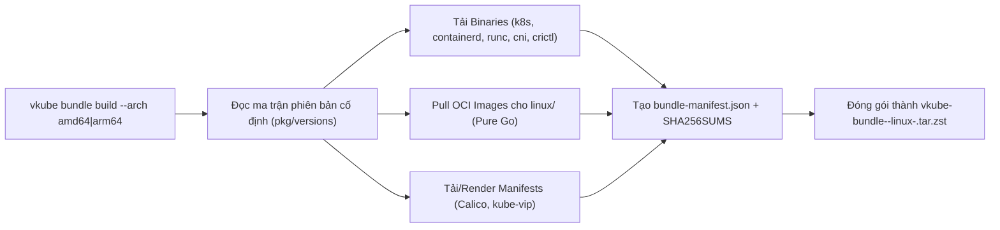
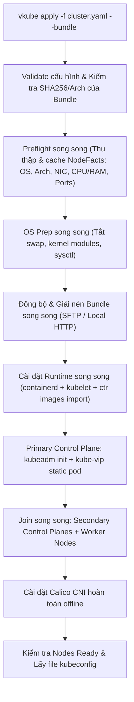

# Kiến trúc hệ thống `vkube`

## 1. Tổng quan & Nguyên tắc thiết kế

`vkube` là một công cụ **CLI viết bằng Pure Go** điều phối trực tiếp quá trình cài đặt Vanilla Kubernetes thông qua `kubeadm` trên các cụm máy chủ Linux On-premise và Air-gapped.

### Nguyên tắc cốt lõi
1. **Cross-platform Deployer:** File binary `vkube` phải chạy đồng nhất trên **Linux, macOS và Windows** (`amd64` và `arm64`). Toàn bộ kết nối mạng, SSH, nén/giải nén (`tar.zst`), kiểm tra checksum và máy chủ HTTP cục bộ (khi phân phối file) đều được viết bằng Pure Go — tuyệt đối không gọi ra các lệnh ngoài của hệ điều hành máy chạy CLI (`ssh`, `scp`, `tar`, `python`, `ansible`, `docker`).
2. **Multi-arch Target Nodes:** Mỗi bản phát hành hỗ trợ đồng thời cả **`linux/amd64`** và **`linux/arm64`** (Ubuntu 22.04 / 24.04 LTS ở v0.1). Kiến trúc của máy chạy CLI hoàn toàn tách biệt với kiến trúc của các server đích thông qua cờ `--arch amd64|arm64`.
3. **Air-gapped First:** Tách bạch hoàn toàn bước thu thập artifact có Internet (`bundle build`) khỏi bước triển khai cụm (`apply`). Các server đích không cần bất kỳ kết nối Internet nào trong lúc cài đặt.
4. **Tối ưu tốc độ tối đa:** Hướng tới tốc độ dựng cụm tiệm cận K3s (**~2.5–4.5 phút** trên OS trắng; **~1.5–2.5 phút** trên Golden Image) bằng cách:
   - Loại bỏ toàn bộ overhead kiểm tra đa distro như trên Ansible/Kubespray.
   - Chạy song song toàn bộ các bước chuẩn bị OS, truyền Offline Bundle và nạp image (`ctr -n k8s.io images import`) trên tất cả các node.
   - Dùng `kube-vip` dưới dạng static pod cho Control Plane HA (không cần dựng HAProxy/Keepalived rời).
   - Thiết kế sẵn để v0.3 nhận diện **Golden Image (Packer)** và tự động bỏ qua bước truyền/nạp artifact khi đã được bake sẵn.

---

## 2. Luồng hoạt động chính

### 2.1 Đóng gói Offline Bundle (`vkube bundle build`)

Chạy trên bất kỳ máy nào có Internet (Linux, macOS hoặc Windows) để tạo ra gói cài đặt độc lập cho kiến trúc đích đã chọn.



**Cấu trúc bên trong Offline Bundle (`vkube-bundle-<ver>-linux-<arch>.tar.zst`):**
```text
bundle-manifest.json          # Ma trận phiên bản, kiến trúc đích, thời gian build, checksums
bin/
  kubeadm
  kubelet
  kubectl
  crictl
  containerd
  containerd-shim-runc-v2
  ctr
  runc
cni-plugins/                  # Bộ CNI plugins chuẩn (bridge, loopback, portmap, ...)
images/
  kubernetes.tar              # kube-apiserver, controller-manager, scheduler, proxy, pause, coredns, etcd
  calico.tar                  # Các image của Calico (cni, node, kube-controllers)
  kube-vip.tar                # Image kube-vip cho HA VIP
manifests/
  calico.yaml                 # Manifest Calico đã render sẵn
  kube-vip.yaml               # Template static pod cho HA Control Plane
```

### 2.2 Triển khai cụm (`vkube apply`)

Chạy từ máy Deployer tới các Target Nodes qua giao thức SSH (Pure Go).



---

## 3. Quy tắc Versioning & BOM (`versions.yaml`)

`vkube` sử dụng quy tắc đặt tag bám sát phiên bản Kubernetes:

```text
v<k8s-version>-vkube.<rev>
```

- Ví dụ: `v1.32.2-vkube.1`, `v1.32.2-vkube.2`
- **Không hardcode trong code Go:** Toàn bộ phiên bản thành phần, URL template tải binary/manifest và danh sách OCI images được khai báo tách biệt trong file BOM mặc định `pkg/versions/versions.yaml` (nhúng sẵn vào binary qua `//go:embed`):
  - Kubernetes (`kubeadm`, `kubelet`, `kubectl`)
  - `containerd` & `runc`
  - `cni-plugins` & `crictl`
  - **Calico** (CNI mặc định cho v0.1)
  - `kube-vip` (HA Control Plane VIP)
- **Ghi đè linh hoạt qua `--manifest`:** Người dùng có thể chỉnh sửa trực tiếp 1 dòng version trong file `versions.yaml` tùy chỉnh và truyền `--manifest ./my-versions.yaml` khi chạy `vkube bundle build` để build đè ngay mà không cần biên dịch lại `vkube`.

---

## 4. Cấu trúc thư mục

```text
vkube/
├── cmd/vkube/              # Entrypoint CLI & các subcommand (Cobra)
├── pkg/
│   ├── api/                # Schema ClusterConfig (cluster.yaml), BundleManifest & validation
│   ├── versions/           # Ma trận phiên bản khóa cứng & URL tải artifact đa kiến trúc
│   ├── bundle/             # Logic build Offline Bundle, pull OCI image bằng Pure Go, verify
│   ├── ssh/                # SSH client Pure Go, chạy lệnh song song, truyền file SFTP/HTTP
│   ├── engine/             # Các stage triển khai (preflight, os-prep, runtime, kubeadm, cni, reset)
│   └── templates/          # Template nhúng sẵn (go:embed) cho kubeadm, containerd, systemd, kube-vip
├── manifests/              # Manifest/template mặc định cho các addon offline
├── lab/                    # Hướng dẫn & script dựng lab VM (VMware Fusion ARM64, Multipass, Lima)
├── docs/                   # Tài liệu ARCHITECTURE.md, PLAN.md và hướng dẫn vận hành
├── clusters/               # Quản lý cấu hình nhiều cụm & file mẫu chuẩn cluster_template.yaml
├── Makefile                # Cross-compile (linux/darwin/windows x amd64/arm64), test, vet, fmt
├── AGENTS.md               # Quy tắc kỹ thuật, ngôn ngữ & quy trình làm việc cho AI/Contributor
└── .agent/skills/vkube-dev/# Project Skill cho AI khi phát triển vkube
```
